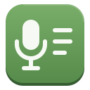
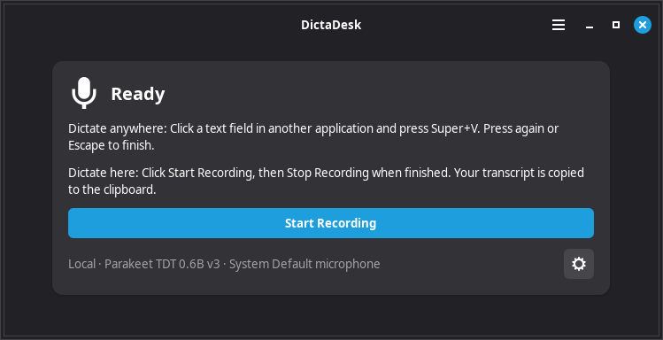
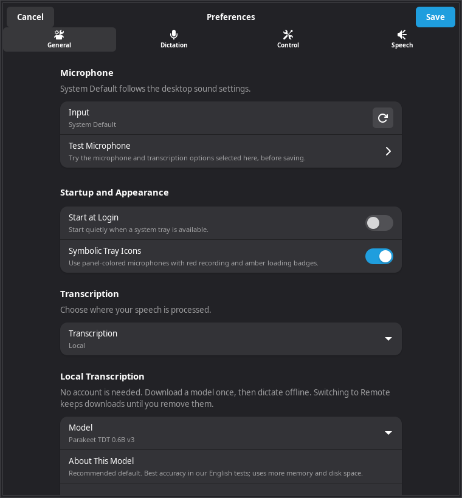
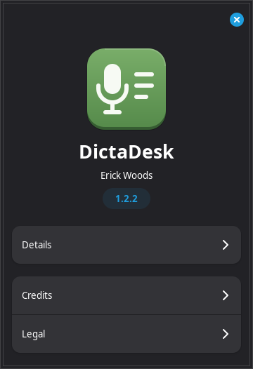

DictaDesk
=========

**Desktop Dictation for Linux**

Speak into a text field using a keyboard shortcut, or record in DictaDesk and
copy the result. Built with Python, GTK 4 and libadwaita, with a tray workflow
for Cinnamon. Local transcription is the default.

`Download DictaDesk 1.0.10 for Linux (.deb) <https://github.com/woodpile72/DictaDesk/releases/download/v1.0.10/dictadesk_1.0.10_amd64.deb>`_
· `Release notes <https://github.com/woodpile72/DictaDesk/releases/tag/v1.0.10>`_
· `Report an issue <https://github.com/woodpile72/DictaDesk/issues>`_

Screenshots show the actual DictaDesk 1.0.8 interface in an isolated demonstration
profile, with simulated readiness and sample text. No personal transcripts or
credentials are shown.

Install
-------

Developed and tested on **Linux Mint 22.3 Cinnamon, X11, x86-64 (amd64)**.
Download the Debian package and
`SHA256SUMS <https://github.com/woodpile72/DictaDesk/releases/download/v1.0.10/SHA256SUMS>`_
into the same folder, then run::

    sha256sum --ignore-missing -c SHA256SUMS
    sudo apt install ./dictadesk_1.0.10_amd64.deb

Check that the checksum reports ``OK``, then launch **DictaDesk** from your
application menu. Open Preferences and download a local model before recording.
The package includes its Python runtime dependencies; models download separately.
It requires Python 3.12, GTK 4.14+ and libadwaita 1.5+. It uses the CPU and does
not require an NVIDIA card. Quit the app before future upgrades.

Start dictating
---------------

1. Wait for **Ready**. Select your microphone in Preferences if needed; the
   microphone test helps check input and recognition.
2. Click a text field in another application. Press **Super+V**, speak, then
   press **Super+V** again or **Escape** to finish. Text is inserted at pauses.
   Recording also stops after **20 seconds of continuous silence**. Speaking
   again before then resets the timer.
3. For longer dictation, **Super+Shift+V** starts continuous mode with stable
   text insertion while speaking. Press it again or **Escape** to finish.

Short pauses show text without finalizing the sentence ending. By default,
DictaDesk waits 4.5 seconds of silence to finalize it; stopping also finalizes it.
The 20-second auto-stop applies only to the ordinary dictation shortcut;
continuous mode and button recordings retain their existing stop controls.
Both pause lengths are adjustable in Preferences. Explicit spoken punctuation
is respected when that option is enabled. Recognition can still infer punctuation
within a phrase. A few trailing words stay provisional so recognition can revise
them when you continue. In-window drafts can change freely; text already inserted
into another application is never automatically overwritten.

Shortcuts are configurable. If another application owns one, choose another in
Preferences. **Start Recording** records into DictaDesk's own text area; finishing
copies that transcript to the clipboard. Last Transcript provides recovery and
manual copying if automatic insertion fails.

With a working tray, closing the window keeps DictaDesk running. Click the tray
icon to reopen it, or choose **Quit** to exit. Optional **Start at Login** starts
hidden in the tray. The microphone and recording/loading badges show its state.

Local or remote
---------------

**Local:** audio is processed on your computer after the model download.
**Parakeet** is the default. Moonshine Tiny (English), Whisper Base and Whisper
Tiny are alternatives. Preferences includes a model guide, download sizes and
separate Download/Remove controls. Changing models or selecting Remote keeps
existing downloads. An installed model loads automatically when needed.

**Remote:** explicitly select OpenAI GPT Transcribe and supply an API key.
Audio is sent to OpenAI and API charges apply. Saved keys use the desktop
keyring. The connection test sends no audio and checks model visibility; it
does not verify transcription billing or quota. Remote mode sends bounded audio
snapshots, not a continuous Realtime stream.
A resumed phrase is transcribed again with its earlier context; repeated snapshots
can increase API usage. It is never an automatic fallback
when local recognition fails.

What it does
------------

* Dictation into other applications, with focus checks and recoverable text if
  insertion cannot continue safely.
* In-window recording with live text and copy-on-finish.
* Spoken punctuation, including parentheses, brackets, braces and “dot dot dot”.
* Built-in DictaDesk name casing, plus a personal correction dictionary with
  an undo action. Personal rules take priority.
* Microphone selection and a short record/transcribe test.
* Configurable shortcuts, recording notifications, tray state icons and optional
  startup at login.
* Model download verification, separate model removal and idle unloading.

Current scope
-------------

Global shortcuts and automatic insertion currently require **X11**. Wayland,
other desktops, other distributions and ARM machines have not been validated.
GNOME needs a compatible tray extension for tray operation. Full screen-reader
acceptance and a fresh installation on a second machine remain outstanding.
The package has been checked in an isolated installation using this machine's
system libraries; that is not a fresh Mint VM test.

Recognition varies by voice, language and background noise. Parakeet performed
best in our small English tests; that is not a universal accuracy claim.
Moonshine Tiny is English-only. Whisper Tiny sometimes omitted or repeated text
in our tests. Long recordings are split for models with limited audio context.
Live insertion can pause if a model revises text already inserted. Check important
text before sending it. A live paid OpenAI transcription request is still unverified.

Recordings are temporary; recent transcription stays in memory unless exported.
There is no telemetry. Removing the Debian package also removes its downloaded
models for all accounts, but retains user settings, keyring entries and exported
transcripts. Upgrades retain models. Use Preferences to remove individual models.

Source and development
----------------------

Source uses a ``src/dictadesk`` layout. Build and test instructions are in
`DEVELOPMENT.rst <DEVELOPMENT.rst>`_. Installer binaries belong in GitHub Releases;
model weights, dependency wheels and local caches are not part of this repository.

License and credits
-------------------

Copyright 2026 Erick Woods. Licensed under `GPL-3.0-only <LICENSE>`_.

Thanks to Python, GTK, libadwaita, PyGObject, ONNX Runtime, onnx-asr, NVIDIA
Parakeet, Moonshine, Whisper and the other libraries that make dictation possible.
Dependencies, models and supplied launcher artwork retain their own licenses.
See `NOTICE <NOTICE>`_ for acknowledgments and the artwork license.
